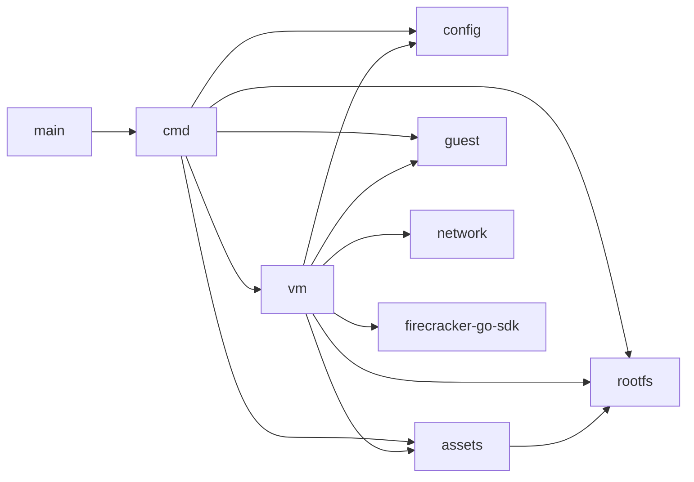

# Architecture

fcvm is a root-required Linux CLI that manages Firecracker microVM lifecycle: download assets, build rootfs images, start/stop jailed VMs, inject env and mounts, and run commands in guests over SSH or vsock.

## Packages



| Package | Role |
|---------|------|
| `cmd/` | Cobra commands and Viper config loading |
| `config/` | Config types, defaults, path expansion, validation |
| `vm/` | Lifecycle manager, Firecracker SDK wiring, persisted state |
| `network/` | TAP setup/teardown, CNI teardown, NFS exports |
| `guest/` | SSH key management, exec/shell, vsock client, serial log tail |
| `guest/agent/` | Guest vsock command agent (`fcvm-guest-agent`) |
| `vsock/` | Shared vsock ports/protocol constants |
| `assets/` | Download Firecracker/jailer/kernel/rootfs; patch ext4 |
| `rootfs/` | Docker → ext4 build; guest bootstrap hooks |

There is no `internal/` package; packages live at the module root.

## Constraints

- Always runs Firecracker through the **jailer** (no opt-out).
- Requires **root** (jailer, TAP/NAT, NFS) and **`/dev/kvm`**.
- Multiple VMs run side-by-side via unique IDs and index-based TAP/UID allocation.

## On-disk layout

Default state directory: `~/.fcvm` (respects `SUDO_USER` home when run under sudo).

```
~/.fcvm/
  bin/firecracker
  bin/jailer
  images/vmlinux
  images/rootfs.ext4
  id_ed25519          # host SSH private key for guests
  jailer/firecracker/<id>/root/...   # jailer chroot tree per VM
  exports/<id>-<n>/share             # bind-mount staging for NFS mounts
  .lock               # guards VM index allocation
  .ip_forward.orig    # host ip_forward value, restored when the last VM stops
  vms/<id>/
    rootfs.ext4       # per-VM copy of the template rootfs
    mount-<n>.ext4    # block-method mount images
    config.json       # VM configuration, written once at creation
    state.json        # runtime metadata, present only while the VM runs (or crashed)
    stopped.json      # written by a deliberate stop, removed on the next start
    console.log       # Firecracker's stdout/stderr: the guest serial console and jailer errors (appended across boots)
```

`config.json` is the shape the VM was created with (machine knobs, network mode, network index and resolved TAP addresses, mounts, env, vsock, jailer settings). It is never modified, and a restart reuses it, so a flag or config change cannot drift a VM away from the disk it was provisioned on. It also keeps the VM's network index claimed while it is stopped.

A VM's status is derived from these files and the live process, never stored: `running` (process alive, identified by PID plus start time), `stopped` (stop record, no process), `crashed` (runtime state but no stop record and no process), `legacy` (runtime state but no `config.json`; created before VMs could be restarted).

`state.json` records id, network index, pid and its `/proc` start time, socket, network mode (tap/cni), tap device, host egress interface, guest subnet, guest IP/MAC, SSH key path, chroot/log paths, optional vsock UDS/CID (when started with `--enable-vsock`), jailer uid/gid, mounts, and env.

VM ids are validated before they are used as path components: letters, digits, `-`, `_` and `.`, up to 64 characters. Everything under this tree is created and removed as root, so an id like `../../etc` is rejected rather than joined into a path.

## Start lifecycle

`vm.Manager.Start` (must be root):

1. Validate the id and config; take the state lock.
2. If the VM already exists, take the restart path below instead; otherwise wipe any leftover jailer tree for the ID.
3. Require firecracker, jailer, kernel, and rootfs on disk.
4. Allocate the lowest free VM index → TAP subnet (or CNI) and jailer uid/gid; write `config.json`, which claims the index.
5. Copy template rootfs → `vms/<id>/rootfs.ext4`; in one loop mount, inject hooks, SSH authorized keys, env, and (TAP mode) `/etc/fcvm/network`; when `enable-vsock` is set, also inject the guest vsock agent; `chown` for the jailer.
6. Set up TAP and this VM's firewall rules (or defer networking to the SDK CNI path); build any `method=block` mount images.
7. Build Firecracker config (drives, machine knobs, MMDS v2, NIC, optional vsock device, full `JailerCfg`) → `NewMachine` → `Start`.
8. In CNI mode, resolve guest IP/gateway/MAC from the SDK result.
9. Create NFS exports scoped to the resolved guest IP; save `state.json`; wait for SSH; push `/etc/fcvm/mounts` and apply it in the guest.
10. Background `machine.Wait`.

Env is baked into the rootfs at step 5, so it survives reboots and does not depend on SSH. The mount table is pushed at step 9 because NFS exports cannot be scoped until the guest address is known.

If no VM id is given, fcvm generates `vm-<unix-timestamp>`.

## Stop, restart, delete and cleanup

- **Stop:** under the state lock (as are delete, cleanup and the stop half of restart, so they cannot race a start that is mid-creation). Confirm the PID is still this VM (PID plus `/proc` start time), SIGTERM, poll until `stop-timeout`, SIGKILL only if still alive, then wait again; if the process is still there the stop fails and nothing else is touched. Mirror writable block mounts (for a crashed VM only if `e2fsck -fn` passes) back to their host directories; tear down TAP rules or CNI+netns; unexport NFS; remove the jailer tree. Then write `stopped.json` and remove `state.json`, in that order, so a stop interrupted partway still reads as `crashed`. The disk, block images, `config.json` and the network index are kept. When no VM is running any more, remove the `FCVM` chain and restore `ip_forward`: a stopped VM holds no host networking.
- **Start of an existing VM (stopped or crashed):** load `config.json` and use its saved shape (current config still supplies binaries, kernel and state dir); for a crash, tear down the leftovers first; skip the rootfs copy and patch, and reuse block mount images instead of rebuilding them from the host directory; set up the same index, TAP addresses and jailer uid; boot; create NFS exports against the guest address of this boot (in CNI mode it may differ from last time); write `state.json`; then remove `stopped.json`. A failure before that point releases only what this attempt took and leaves the VM stopped with its disk intact. Firecracker is launched with a context that is not cancelled when the command returns (the SDK stops the VM on cancellation); Ctrl+C while waiting for the guest stops the VM explicitly, removing it if it was being created and leaving it `stopped` if it was being restarted. A failed *creation* still removes everything.
- **Restart:** stop if running, then start.
- **Delete:** the same full teardown as cleanup, plus removing the VM directory, which frees its index. Refuses a running VM without `--force`.
- **Cleanup:** same teardown as delete; works with or without records (best-effort orphans). `cleanup --all` walks all VMs under the state dir, stopped ones included.

Restart is a cold boot from the preserved disk, not a Firecracker snapshot restore; see [ADR 0001](adr/0001-stop-preserves-the-vm.md).

## Guest bootstrap

Hooks injected into the rootfs (`rootfs.InjectHooks`) provide:

| Path | Role |
|------|------|
| `/usr/local/bin/fcvm-mmds.sh` | MMDS v2 token + GET helpers (`169.254.169.254`) |
| `/usr/local/bin/fcvm-apply-mounts.sh` | Mount everything listed in `/etc/fcvm/mounts` |
| `/usr/local/bin/fcvm-start.sh` | Bring up net, DNS, mounts |
| `/etc/fcvm/env` | Env, written by the host with shell quoting; sourced by `/etc/profile.d/fcvm.sh` |
| `/etc/fcvm/mounts` | Mount table, tab-separated `method`, `source`, `guest` |
| `/etc/systemd/system/fcvm-start.service` | systemd oneshot |
| `/etc/rc.local` | non-systemd fallback |

The guest does not parse JSON. The host already knows the env and mount tables, so it writes them as plain files and the guest scripts just read fields. MMDS stays enabled and reachable for your own use.

Host control plane after boot is **SSH** over the guest IP (`fcvm exec` / `fcvm shell`). With `--enable-vsock`, also **vsock** (`fcvm vsock-exec`).

## Jailer

Every VM uses Firecracker’s jailer with a chroot under `jailer.chroot-base-dir` (default `~/.fcvm/jailer`). Credentials default to uid/gid `1000`. With `jailer.per-vm-uids: true`, uid/gid become `base + index` (ensure those accounts exist on the host).

Optional jailer knobs: NUMA node, daemonize, parent cgroup, and cgroup resource strings (see [configuration.md](configuration.md)). Start records the Firecracker PID from `firecracker.pid` in the jail root so stop/list stay correct when `jailer.daemonize` is true.

## Related docs

- [network.md](network.md) — TAP vs CNI, NFS
- [rootfs.md](rootfs.md) — image build and hooks
- [kernel.md](kernel.md) — stock and custom kernels
- [cli.md](cli.md) — command reference
- [debug.md](debug.md) — host-side inspection without the CLI
